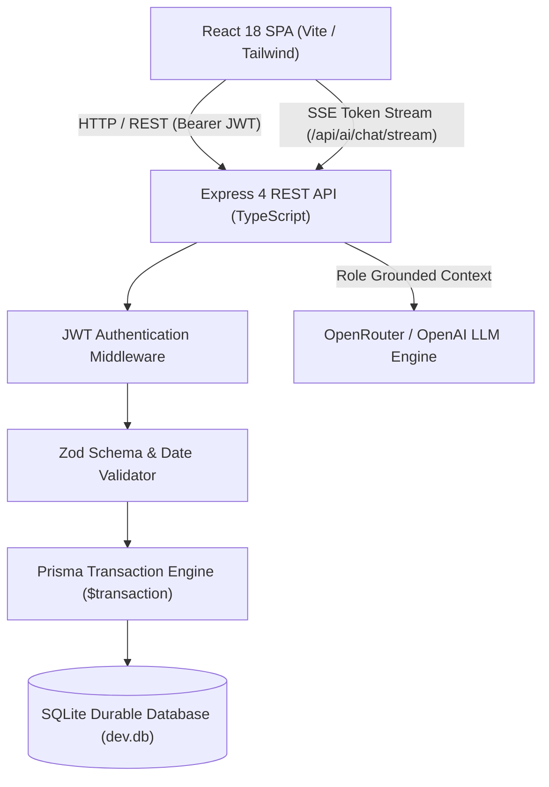

# TailVaR Consulting - Insurance Policy & Claims Management System

> **Founding Engineer Hiring 2026: Take-Home Assignment**  
> **Branch:** `feature/ai-and-extended-features` (AI Copilot + Extended Management Views)  
> Candidate: Parag  
> Repository: `https://github.com/paragakabari001/insurance-policy-claims-manager`  
> Submission Deadline: 7 November 2026, 11:59 PM IST  
> Operational Guarantee: 30 November 2026, 11:59 PM IST  

---

## Live Application URLs

| Branch | Description | Live Deployment URL |
| :--- | :--- | :--- |
| **`main`** | **Official Submission (Strict PDF Spec)** | `https://insurance-policy-claims-manager.onrender.com` *(or your Vercel/Render URL)* |
| **`feature/ai-and-extended-features`** | **Extended Version (AI Copilot + Customers)** | `https://insurance-policy-claims-manager-ai.onrender.com` *(or your Vercel/Render URL)* |

---

## 1. Project Overview & Extended Features

This branch contains the **Extended Full-Featured Version** of the Insurance Policy & Claims Management System, including an authenticated **AI Policy & Claims Copilot Assistant** with Server-Sent Events (SSE) token streaming, and an extended **Customers Analytics & Distribution View**.

### Implemented Workflows & Extended Modules

#### 1. Core Specification Workflows
- **Authentication & RBAC:** Pre-configured with the three required evaluation accounts (`customer1`, `customer2`, `admin`) with signed JWT authorization.
- **Admin Policy Issuance:** Rejects inverted dates (`endDate < startDate`) and non-positive SI.
- **Customer Claims Submission:** Rejects incident dates outside coverage start/end dates.
- **Strict SI Accounting:** Submitted claims block SI immediately; Approved claims consume SI; Rejected claims release SI.
- **Cards & Table View Toggles:** Seamless switcher on all data views.
- **Whitespace-Nowrap IDs:** Ensured policy and claim IDs (`POL-1005-6554`, `CLM-1001`) never break into multiple lines.

#### 2. AI Policy & Claims Assistant (Copilot)
- **Interactive Floating & Drawer Panel:** Docked right-hand copilot launcher with smooth animated open/close drawer.
- **Server-Sent Events (SSE) Streaming:** `/api/ai/chat/stream` streams tokens in real-time with responsive markdown rendering and typing effect.
- **Zero-Trust Access Control:** Chat requests hit an authenticated server-side endpoint (`POST /api/ai/chat/stream`). Identity and role are derived strictly from the verified JWT bearer session.
- **Role-Aware Data Grounding:**
  - **Customer:** Assistant answers questions grounded strictly in their own active policies and claims without exposing other customers' data or administrative functions.
  - **Administrator:** Assistant summarizes global metrics, flagged claims, and policy distribution.
- **Strict Safety & Scope Redirection:** For questions outside the scope of insurance policies or claims in this app, the assistant politely declines:
  > *"I can help with your insurance policies and claims in this app. Please ask about coverage, remaining balance, claim status, or submitting a claim."*
- **Multilingual Support:** Tested and verified to respond fluently in English, Gujarati, and Hindi.

#### 3. Customers Management View
- Comprehensive customer dashboard displaying customer summaries, active policy count, claim resolution rates, policy/claim distribution bar charts, and recent activity logs.

---

## 2. Technology Stack and Rationale

| Layer | Technology | Rationale |
| :--- | :--- | :--- |
| **Frontend** | React 18, TypeScript, Tailwind CSS, Lucide Icons, Markdown Renderer | Responsive UI with strict typing and modern aesthetic without heavy external component libraries. |
| **Backend** | Node.js, Express, TypeScript | High performance RESTful service with SSE token streaming. |
| **ORM & Database** | Prisma ORM, SQLite (`dev.db`) | Type-safe queries, zero-setup local evaluation, ACID transactional isolation. Swappable to PostgreSQL via `DATABASE_URL`. |
| **AI Integration** | OpenRouter / OpenAI API (SSE Streaming) | Low latency, role-isolated conversational intelligence grounded in real-time application database state. |
| **Security** | bcryptjs, jsonwebtoken, zod | Industry-standard password hashing, stateless JWT authorization, and runtime schema validation. |
| **Testing** | Jest, Supertest | 28 automated integration tests covering authentication, boundary cases, SI accounting, race conditions, and AI security. |
| **Containerization** | Docker, Docker Compose | Multi-stage production build providing reproducible zero-dependency deployments. |

---

## 3. System Architecture



---

## 4. Environment Variables Configuration

Create a `.env` file in the root directory or configure in your cloud dashboard:

```env
# Server Port
PORT=5001

# Runtime Environment
NODE_ENV=production

# Database Connection
DATABASE_URL="file:./dev.db"

# JWT Secret Key (Use a strong random secret in production)
JWT_SECRET="tailvar_secure_production_jwt_secret_2026_eval"

# AI Copilot Provider (OpenRouter / OpenAI Compatible)
AI_API_KEY="your_openrouter_or_openai_api_key_here"
AI_BASE_URL="https://openrouter.ai/api/v1"
AI_MODEL="openai/gpt-4o-mini"
```

---

## 5. Deployment Guide

### Option 1: Deploy on Render.com (Recommended for Node + SQLite)
1. Sign in to [Render.com](https://render.com) and click **New +** $\rightarrow$ **Web Service**.
2. Connect your GitHub repository: `paragakabari001/insurance-policy-claims-manager`.
3. Configure the Web Service:
   - **Name:** `insurance-policy-ai-extended`
   - **Branch:** `feature/ai-and-extended-features`
   - **Build Command:** `npm run build`
   - **Start Command:** `npm start`
   - **Environment Variables:** Add `NODE_ENV=production`, `JWT_SECRET=your_jwt_secret`, `DATABASE_URL=file:./dev.db`, and `AI_API_KEY=your_key`.
4. Render deploys the web service and provides a public HTTPS URL!

### Option 2: Deploy on Vercel
1. Import repository on [Vercel](https://vercel.com).
2. Set Framework Preset to **Vite** or **Other**.
3. Select branch: `feature/ai-and-extended-features`.
4. Configure Environment Variables: `JWT_SECRET`, `NODE_ENV=production`, `AI_API_KEY`.
*(Note: If deploying serverless on Vercel, SQLite database files reset on cold lambda restarts; for permanent persistence, Render/Railway or a hosted PostgreSQL URL is recommended).*

---

## 6. Local Setup and Execution

```bash
# 1. Clone repository
git clone https://github.com/paragakabari001/insurance-policy-claims-manager.git
cd insurance-policy-claims-manager
git checkout feature/ai-and-extended-features

# 2. Install all dependencies (root, server, and client)
npm run postinstall

# 3. Setup and seed database
npm run seed

# 4. Build client and server
npm run build

# 5. Start unified application (Server + UI on port 5001)
npm start
```
Access the application at: `http://localhost:5001`

---

## 7. Automated Tests Performed

```bash
npm test
```
All **28 / 28 test cases passed** covering:
- Authentication & JWT token security
- Cross-customer data isolation
- Coverage date boundary inclusion & rejection
- Immediate SI blocking, approval, rejection restoration, and decision immutability
- Serialized concurrency race conditions
- AI Policy Assistant security boundaries & input validation

---

## 8. AI Tools Used & Conversation Logs

### AI Tools Utilized
- **Gemini & Claude (Advanced Agentic Assistant):** Used for scaffolding, UI refinement, formulating concurrency race-condition tests, and documentation.
- **Location of Submitted AI Conversation Logs:**
  - `docs/ai-logs/ai-development-log.md`
  - `logs/ai-conversation-log.md`
  - Included in root submission archive: `submission-insurance-policy-claims-manager.zip`.

---

## License & Confidentiality
This submission was developed confidentially for TailVaR Consulting Founding Engineer Hiring 2026.
