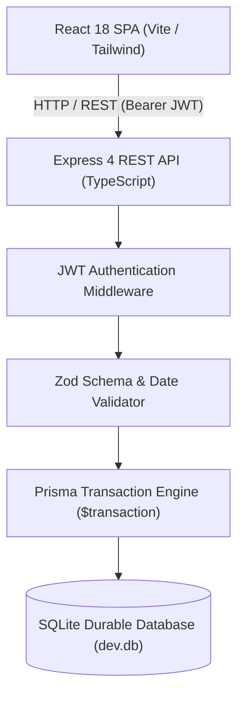

# TailVaR Consulting - Insurance Policy & Claims Management System

> **Founding Engineer Hiring 2026: Take-Home Assignment**  
> Candidate: Parag  
> Repository: `https://github.com/paragakabari001/insurance-policy-claims-manager`  
> Branches: `main` (Strict Specification) & `feature/ai-and-extended-features` (AI & Extended UI)  
> Submission Deadline: 7 November 2026, 11:59 PM IST  
> Operational Guarantee: 30 November 2026, 11:59 PM IST  

---

## Live Application URLs

| Branch | Description | Live Deployment URL |
| :--- | :--- | :--- |
| **`main`** | **Official Submission (Strict PDF Spec)** | `https://insurance-policy-claims-manager.onrender.com` *(or your Vercel/Render URL)* |
| **`feature/ai-and-extended-features`** | **Extended Version (AI Copilot + Customers)** | `https://insurance-policy-claims-manager-ai.onrender.com` *(or your Vercel/Render URL)* |

---

## 1. Project Overview and Implemented Features

This project is a fullstack insurance policy and claims management web application developed for the TailVaR Consulting Founding Engineer assessment. It provides an isolated, role-based platform where administrators can issue policies and adjudicate claims, while customers can view only their own policies and submit claims against available coverage limits.

### Core Implemented Workflows

#### 1. Authentication & Role-Based Access Control
- Pre-configured with the three required evaluation demo accounts:
  | Role | Username | Password | Access Boundary |
  | :--- | :--- | :--- | :--- |
  | **Customer 1** | `customer1` | `Customer1@Demo26` | Isolated to Customer 1 policies and claims |
  | **Customer 2** | `customer2` | `Customer2@Demo26` | Isolated to Customer 2 policies and claims |
  | **Administrator** | `admin` | `Admin@Demo26` | Global access: policy creation, claim adjudication |
- **Session Security:** Cryptographic JSON Web Tokens (JWT) signed with `JWT_SECRET`. Tokens are validated per-request via bearer authorization headers.
- **Role Isolation:** Customers cannot view or claim against another customer's policy (enforced server-side with HTTP 403). Customers cannot access administrative endpoints.
- **Logout:** Explicit logout endpoint and frontend button clearing session storage and redirecting to login.

#### 2. Policy Management (Administrator)
- **Policy Creation:** Admin creates policies for either `customer1` or `customer2` with coverage start date, end date, and Sum Insured (SI).
- **Validation Rules:**
  - Rejects inverted dates (`endDate < startDate`) with descriptive error messages.
  - Rejects non-positive SI amounts (`sumInsured <= 0`).
  - Dates standardized on calendar format (`YYYY-MM-DD`).
- **Policy Overview:** Complete table and cards view displaying original SI, remaining claimable SI, coverage dates, and active status calculated dynamically using `Asia/Kolkata` (IST).

#### 3. Claims Submission & Adjudication
- **Customer Claim Submission:**
  - Customers submit claims against their active policies.
  - **Date Boundary Validation:** Incident date must fall within coverage dates, inclusive (`startDate <= incidentDate <= endDate`), accepted even for expired policies.
  - **Balance Boundary Validation:** Amount must be positive (`> 0`) and cannot exceed current remaining claimable SI.
- **SI Claim Accounting Rules:**
  $$\text{Remaining Claimable SI} = \text{Original SI} - \sum \text{Submitted Claims} - \sum \text{Approved Claims}$$
  - **Submitted Claims:** Reserve/block SI immediately upon submission.
  - **Approved Claims:** Permanently consume the blocked SI.
  - **Rejected Claims:** Immediately release the blocked SI so that it can be claimed again.
  - **Decision Immutability:** Only claims in `Submitted` status can be approved or rejected. Decided claims cannot be re-decided.
- **Concurrency & Race Condition Safety:** Claim submissions and decisions are executed inside serialized database transactions (`prisma.$transaction`) to prevent double-spending under concurrent requests.

#### 4. Frontend Usability Enhancements
- **View Toggle:** Seamless toggle between **Table View** and **Card Grid View** on policies and claims.
- **No Line-Wrapping on IDs:** Applied `whitespace-nowrap font-bold` to Policy IDs (`POL-1005-6554`) and Claim IDs (`CLM-1001`) preventing split-character line wraps.
- **Radix Popover Datepicker:** Clean top-oriented popover calendar avoiding clipping inside modal windows.
- **Currency Formatting:** Full monetary precision formatted in Indian Rupee notation (`₹ 10,00,000.00`).

---

## 2. Technology Stack and Rationale

| Layer | Technology | Rationale |
| :--- | :--- | :--- |
| **Frontend** | React 18, TypeScript, Tailwind CSS, Lucide Icons | Responsive UI with strict typing and modern aesthetic without heavy external component libraries. |
| **Backend** | Node.js, Express, TypeScript | High performance, lightweight RESTful service with modular controllers and middleware. |
| **ORM & Database** | Prisma ORM, SQLite (`dev.db`) | Type-safe queries, zero-setup local evaluation, ACID transactional isolation. Swappable to PostgreSQL via `DATABASE_URL`. |
| **Security** | bcryptjs, jsonwebtoken, zod | Industry-standard password hashing, stateless JWT authorization, and runtime schema validation. |
| **Testing** | Jest, Supertest | Automated integration test suite verifying 28 comprehensive test cases covering authentication, boundaries, accounting, and concurrency. |
| **Containerization** | Docker, Docker Compose | Multi-stage production build providing reproducible zero-dependency deployments. |

---

## 3. System Architecture



### Component Breakdown
1. **Frontend Client (`/client`):** Single-page application built with Vite. Compiles to static assets (`/client/dist`) and served by the Express backend or static CDN.
2. **Backend Server (`/server`):** Express application with modular routes (`/api/auth`, `/api/policies`, `/api/claims`). Handles business logic and date arithmetic.
3. **Database Layer (`/server/prisma`):** SQLite database stored durably in `server/prisma/dev.db`. Automatically seeded on startup with the 3 mandatory evaluation accounts.
4. **Cloud / Hosting Provider:** Deployed as a web service on **Render.com** (or **Railway** / **Vercel**), persisting records across restarts.

---

## 4. Environment Variables Configuration

Create a `.env` file in the root directory or configure in your cloud dashboard:

### For `main` Branch (Core Application):
```env
# Server Port
PORT=5001

# Runtime Environment
NODE_ENV=production

# Database Connection
DATABASE_URL="file:./dev.db"

# JWT Secret Key (Use a strong random secret in production)
JWT_SECRET="tailvar_secure_production_jwt_secret_2026_eval"
```

### For `feature/ai-and-extended-features` Branch:
```env
PORT=5001
NODE_ENV=production
DATABASE_URL="file:./dev.db"
JWT_SECRET="tailvar_secure_production_jwt_secret_2026_eval"

# AI Copilot Provider (Optional: OpenRouter / OpenAI)
AI_API_KEY="your_openrouter_or_openai_api_key_here"
AI_BASE_URL="https://openrouter.ai/api/v1"
AI_MODEL="openai/gpt-4o-mini"
```

---

## 5. Deployment Guide

### Option 1: Deploy on Render.com (Recommended for Node + SQLite)
1. Sign in to [Render.com](https://render.com) and click **New +** $\rightarrow$ **Web Service**.
2. Connect your GitHub repository: `paragakabari001/insurance-policy-claims-manager`.
3. Configure **Service 1 (`main` branch)**:
   - **Name:** `insurance-policy-claims-manager`
   - **Branch:** `main`
   - **Build Command:** `npm run build`
   - **Start Command:** `npm start`
   - **Environment Variables:** Add `NODE_ENV=production`, `JWT_SECRET=your_jwt_secret`, `DATABASE_URL=file:./dev.db`.
4. Configure **Service 2 (`feature/ai-and-extended-features` branch)**:
   - Click **New Web Service**, connect the same repo.
   - **Name:** `insurance-policy-ai-extended`
   - **Branch:** `feature/ai-and-extended-features`
   - **Build Command:** `npm run build`
   - **Start Command:** `npm start`
   - **Environment Variables:** Add the variables above plus `AI_API_KEY`.
5. Both services will be live with public HTTPS URLs!

### Option 2: Deploy on Vercel
1. Import repository on [Vercel](https://vercel.com).
2. Set Framework Preset to **Vite** or **Other**.
3. For deployment of both branches:
   - Deploy `main` as Production.
   - Deploy `feature/ai-and-extended-features` as a separate project or preview branch.
4. Set Environment Variables: `JWT_SECRET`, `NODE_ENV=production`.
*(Note: If deploying serverless on Vercel, SQLite database files reset on cold lambda restarts; for permanent persistence, Render/Railway or a hosted PostgreSQL URL is recommended).*

---

## 6. Local Setup and Execution

```bash
# 1. Clone repository
git clone https://github.com/paragakabari001/insurance-policy-claims-manager.git
cd insurance-policy-claims-manager

# 2. Install all dependencies (root, server, and client)
npm run postinstall

# 3. Setup and seed database
npm run seed

# 4. Build client and server
npm run build

# 5. Start unified application (Server + UI on port 5001)
npm start
```
Access the application at: `http://localhost:5001`

---

## 7. Automated Tests Performed

The project includes a comprehensive integration test suite (`server/src/__tests__/claims.test.ts`) covering all 28 requirements of the take-home assignment:

```bash
npm test
```

### Verification Matrix (28 / 28 Tests Passed)

| Category | Test Case | Status |
| :--- | :--- | :--- |
| **Authentication** | Rejects invalid credentials with HTTP 401 | ✅ PASSED |
| **Authentication** | Successfully executes logout | ✅ PASSED |
| **Authorization** | Rejects unauthenticated requests to protected endpoints (401) | ✅ PASSED |
| **Authorization** | Rejects customer attempting to create policy (403) | ✅ PASSED |
| **Authorization** | Rejects customer attempting to adjudicate claim (403) | ✅ PASSED |
| **Data Isolation** | Customer 1 views only their own policies and claims | ✅ PASSED |
| **Data Isolation** | Customer 1 cannot view Customer 2 policy by ID (403) | ✅ PASSED |
| **Data Isolation** | Customer 1 cannot submit claim against Customer 2 policy (403) | ✅ PASSED |
| **Data Isolation** | Administrator can view all policies across all customers | ✅ PASSED |
| **Validation** | Rejects policy creation if `endDate < startDate` (400) | ✅ PASSED |
| **Validation** | Rejects non-positive Sum Insured (`sumInsured <= 0`) | ✅ PASSED |
| **Validation** | Rejects zero or negative claim amount (`amount <= 0`) | ✅ PASSED |
| **Validation** | Rejects invalid calendar date format (e.g., `2026-02-31`) | ✅ PASSED |
| **Boundaries** | Accepts incident date exactly on coverage `startDate` | ✅ PASSED |
| **Boundaries** | Accepts incident date exactly on coverage `endDate` | ✅ PASSED |
| **Boundaries** | Rejects incident date 1 day before coverage start | ✅ PASSED |
| **Boundaries** | Rejects incident date 1 day after coverage end | ✅ PASSED |
| **Spec Accounting** | Step 1: Submit ₹6,00,000 on ₹10,00,000 SI $\rightarrow$ Remaining ₹4,00,000 | ✅ PASSED |
| **Spec Accounting** | Step 2: Attempt ₹5,00,000 $\rightarrow$ Rejected (exceeds ₹4,00,000) | ✅ PASSED |
| **Spec Accounting** | Submit claim equal to exact remaining SI (₹4,00,000) $\rightarrow$ Accepted | ✅ PASSED |
| **Spec Accounting** | Step 3: Admin rejects ₹6,00,000 claim $\rightarrow$ Balance restores to ₹10,00,000 | ✅ PASSED |
| **Spec Accounting** | Step 4: Now ₹5,00,000 claim can be submitted $\rightarrow$ Accepted | ✅ PASSED |
| **Spec Accounting** | Step 5: Decided claims cannot be decided again (immutability) | ✅ PASSED |
| **Concurrency** | Concurrent claims that together exceed SI cannot breach policy limit | ✅ PASSED |
| **Persistence** | Persists policy and claim records durably across application restarts | ✅ PASSED |
| **Assistant Security** | Rejects unauthenticated requests to AI endpoints (401) | ✅ PASSED |
| **Assistant Security** | Rejects empty or invalid messages (400) | ✅ PASSED |
| **Assistant Security** | Processes authenticated customer chat with safe grounded data | ✅ PASSED |

---

## 8. Edge Cases Identified, Handling & Fixes

1. **Race Conditions / Double-Spending:**
   - *Risk:* Two simultaneous claim requests both read available balance and proceed, exceeding total Sum Insured.
   - *Fix:* Executed all balance checks and insertions within atomic database transactions (`prisma.$transaction`) with database-level isolation.
2. **Timezone Offset Drifts:**
   - *Risk:* Floating UTC timestamps could shift a calendar date across midnight, invalidating legitimate boundary incidents.
   - *Fix:* Standardized strictly on ISO calendar date strings (`YYYY-MM-DD`). Validated format and day-of-month ranges rigorously without UTC offset drift.
3. **Exact Coverage Boundaries:**
   - *Handling:* Inclusive comparisons (`startDate <= incidentDate <= endDate`) ensure incidents occurring on the exact start or end dates are accepted.
4. **Decision Immutability:**
   - *Handling:* Only claims in `Submitted` status can receive an `Approved` or `Rejected` decision. Attempting to decide a settled claim returns HTTP 400.
5. **Monetary Precision:**
   - *Handling:* Amounts are stored as positive floats with explicit rounding (`Math.round(val * 100) / 100`) preventing floating-point drift.

---

## 9. Assumptions, Trade-offs & Limitations

- **Pre-Seeded Accounts:** Fictional demo accounts (`customer1`, `customer2`, `admin`) are pre-seeded automatically on server launch for evaluator convenience.
- **Database Selection:** SQLite was selected for zero-dependency local evaluation and lightweight deployment, with Prisma allowing instant migration to PostgreSQL.
- **Push Notifications:** As specified in Section 1.5, push notifications/WebSockets are not required; updated decisions reflect on refresh or data retrieval.

---

## 10. AI Tools Used & Conversation Logs

### AI Tools Utilized
- **Gemini & Claude (Advanced Agentic Assistant):** Used for scaffolding, UI refinement, formulating concurrency race-condition tests, and documentation.
- **Location of Submitted AI Conversation Logs:**
  - `docs/ai-logs/ai-development-log.md`
  - `logs/ai-conversation-log.md`
  - Included in root submission archive: `submission-insurance-policy-claims-manager.zip`.

---

## License & Confidentiality
This submission was developed confidentially for TailVaR Consulting Founding Engineer Hiring 2026.
